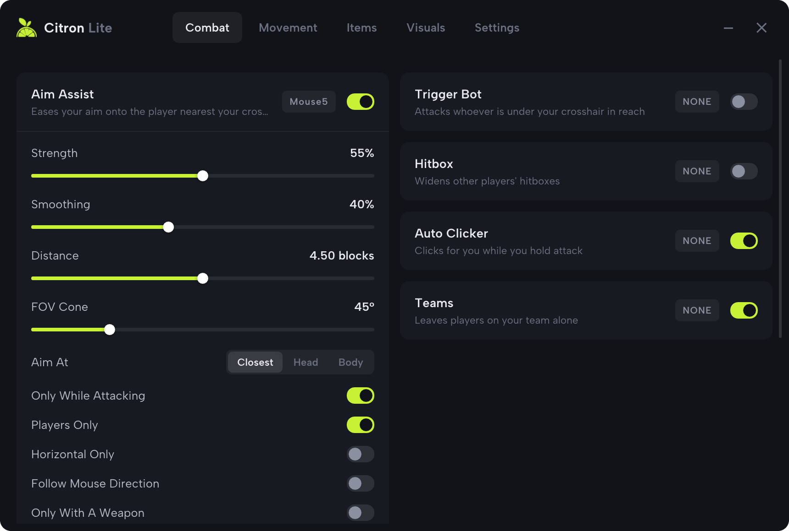
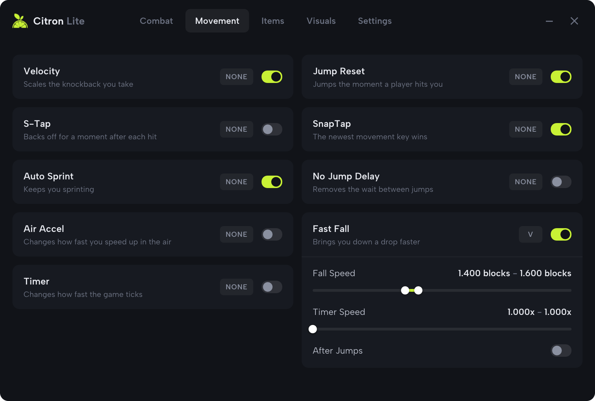
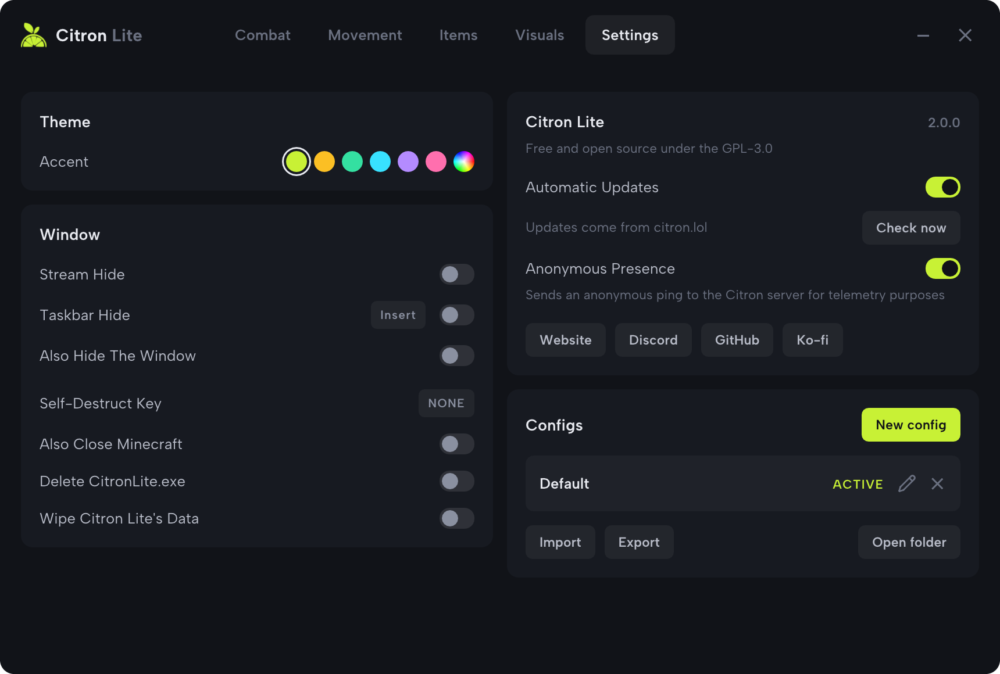

<p align="center">
  <picture>
    <source media="(prefers-color-scheme: dark)" srcset="assets/logo/wordmark-dark.png">
    
  </picture>
</p>

<p align="center">
  A free, open source client for Minecraft: Bedrock Edition on Windows.<br>
  It runs next to the game instead of inside it.
</p>

<p align="center">
  <a href="https://citron.lol">Website</a> ·
  <a href="https://discord.gg/f7JTg86r8A">Discord</a> ·
  <a href="https://github.com/CitronMC/CitronLite/releases">Releases</a>
</p>

<p align="center">
  
</p>

## Getting started

1. Download `CitronLite.exe` from [citron.lol](https://citron.lol) or the [Releases](https://github.com/CitronMC/CitronLite/releases) page.
2. Start it, then start Minecraft (either order works). Nothing is installed and you don't need an account.
3. Join a world or a server, switch on what you want and give it a key.

Citron Lite supports **Minecraft 1.26.52 and 1.26.60** from the Microsoft Store or the Xbox app, on Windows 10 and 11 (64-bit). If you play another version, the window says so and leaves the game alone.

## What's in it

**Combat**

| Module | What it does |
| --- | --- |
| Aim Assist | Eases your aim onto the player nearest your crosshair. You choose the strength, smoothing, distance, the cone it looks in and where it aims (closest point, head or body). |
| Trigger Bot | Attacks whoever is under your crosshair and within reach, at a CPS range you set. |
| Reach | Hits reach further, rolled between the two distances you set. |
| Hitbox | Makes other players' hitboxes wider and taller. With Shadow Spoof the boxes you see stay normal. |
| Ghost Hand | Hits players through blocks. |
| Auto Clicker | Clicks for you while you hold attack. It can break blocks and leaves menus alone. |
| Right Clicker | Clicks for you while you hold use. |
| Teams | Leaves your teammates alone, going by the colour of their name. Auto reads your own colour, or pick one. |
| Friends | Leaves the players on your list alone. Middle click a player to add or remove them. |

**Movement**

| Module | What it does |
| --- | --- |
| Velocity | Takes less knockback, both ranges rolled per hit. |
| Jump Reset | Jumps the moment a player hits you, after a delay you set. |
| S-Tap | Taps back for a moment after each hit you land, then lets you run on. |
| SnapTap | The movement key you pressed last wins, for forward and back, left and right, or both. |
| Auto Sprint | Keeps you sprinting, sideways too if you like. |
| No Jump Delay | Removes the wait between jumps. |
| Air Accel | Changes how fast you speed up in the air. |
| Fast Fall | Brings you down a drop faster. Each fall rolls its own speed from the range you set. |
| Timer | Changes how fast the game ticks. |

**Items**

| Module | What it does |
| --- | --- |
| Keybind Pearl | Throws an ender pearl from your hotbar on its key and switches back. |
| Keybind Snowball | The same for snowballs, eggs too if you want. |
| Keybind Pot | The same for splash potions of healing. |
| No Use Delay | Lets you use items right after a hit. |

**Visuals**

| Module | What it does |
| --- | --- |
| Zoom | Zooms in while you hold its key. Scroll to zoom further. |
| Custom FOV | Sets your field of view past the game's slider. |
| Fullbright | Lights up the whole world. |
| Third Person Nametags | Shows your own nametag in third person. |

**Settings** has Stream Hide (Citron Lite disappears from recordings and streams), Taskbar Hide, a self-destruct key, the accent colour and your configs.

<p align="center">
  
  
</p>

## Keys

Click the key button on a card and press any key, or any mouse button but the left one. A left click cancels and Escape clears the key. Nothing comes with a key already set, except Taskbar Hide on Insert.

- Most modules switch on and off with their key.
- Zoom works while its key is held.
- The item modules and the self-destruct key act once per press.

Citron Lite reads your Minecraft controls. If you moved attack, use, movement, sprint, jump or the hotbar keys in the game's settings, every module uses your keys: Auto Clicker presses your attack, SnapTap watches your movement keys, Keybind Pearl uses your hotbar keys.

## Configs

Settings are saved as you change them. **Configs** in Settings keeps as many as you like: make a new one, rename it, switch between them, or import and export `.citron` files to share. They live in `%LOCALAPPDATA%\CitronLite`, and configs from Citron Lite 1.x still load.

## Updates and privacy

- Updates come from citron.lol. Each download is checked against the hash in the update manifest before it replaces the exe, and you can turn automatic updates off.
- Anonymous Presence sends a random id, made fresh each launch and never saved, so citron.lol can show how many people are online. Switch it off in Settings and nothing is sent.
- There is no account, no login and no analytics beyond that. Nothing about you or your game leaves your PC.

## Questions

**Can I get banned?**
Yes. Any client can get you banned on a server that does not allow it. Read the rules of the server you play on.

**Why does my antivirus complain?**
Citron Lite reads and changes another program's memory, which is what antivirus software watches for. The code is all here: read it, or build it yourself.

**Does it inject into Minecraft?**
No. It is a separate program. It reads the game's memory from outside and changes a few instructions in it, and it puts every one of them back when it closes.

**Minecraft updated and now it says "not supported".**
Each game update moves the code Citron Lite works with. Support for a new version comes with a Citron Lite update.

## For developers

Citron Lite is C++20 with [Dear ImGui](https://github.com/ocornut/imgui) on Direct3D 11, built with MinGW-w64.

### Building

You need MinGW-w64 with GCC 13 or newer ([WinLibs](https://winlibs.com) works well) and a bash shell, such as Git Bash.

```bash
./build_mingw.sh          # build/CitronLite.exe and its update manifest
./build_mingw.sh tests    # build and run the tests
./build_mingw.sh probe    # print what the client reads from a running Minecraft
./build_mingw.sh run      # build, then start it
```

The tests include a full session through the real window: `tools/ui_tests.cpp` starts the exe at five window scales and drives it with real window messages, so a control that isn't where it is drawn fails there.

`CITRON_LTO=0` skips link-time optimisation for a faster build. CMake works too:

```bash
cmake -G Ninja -B build-cmake -DCMAKE_BUILD_TYPE=Release
cmake --build build-cmake
ctest --test-dir build-cmake
```

Start the exe with `--debug` (or put a `debug.txt` in `%LOCALAPPDATA%\CitronLite`) and it writes `citron-lite.log` there.

### How it works

The client never runs code inside the game. It opens Minecraft's process and works on its memory from outside:

- **Reading.** A pointer walk from one global the game stores at startup leads to the client instance, the game's clock and your player. Positions, boxes, name tags and inventory come from the player's entity components.
- **Capturing.** A few small code caves note what the game is working on as it runs: the camera, every actor being drawn, the block or entity under the crosshair, your hurt time.
- **Changing.** Some modules write values (the camera for Aim Assist, your velocity for Velocity), some point an instruction at a number of their own (Reach), some skip one instruction (No Jump Delay).

Every patch is written with the game's threads paused, and all of them come back out when the client closes.

### Source layout

```
src/core/        game.cpp     the supported builds: where each site is, and structure offsets
                 bedrock.cpp  the pointer walk and the reads from the player and other actors
                 engine.cpp   process memory, pattern scans and code caves
                 game_bindings.cpp  the game's own key bindings, from its options file
src/backend/     the worker thread: attaching, the world each tick, input hooks, timing
src/modules/     one file per module or group, by tab
src/ui/          draw.cpp (widgets) and panel.cpp (the window)
src/app.cpp      state, configs and hotkeys       src/model.cpp  the module catalog
tools/           tests, the probe, and the scripts that make the logo and embed the fonts
assets/logo/     mark.svg is the master; tools/make_logo.py makes the icon and the rest from it
```

### A new Minecraft version

Everything that depends on the game build is in `src/core/game.cpp`: a table of sites (an address, plus a byte pattern to check it) and a table of structure offsets for each build. When the version is unknown or a hotfix moves the code, the patterns are searched for instead, and the build whose sites are found where it expects them wins.

To add a version, find each site and offset in the new build, add both tables, then run `./build_mingw.sh probe` with the game open: every site should read `ok`, and in a world it prints your position, box and hotbar. `probe --live` also puts the camera and actor captures in for two seconds and lists what they saw.

### Contributing

Issues and pull requests are welcome. Keep changes small and focused, run the tests, and say which Minecraft version you tried it on.

## License

Citron Lite is free software under the [GNU General Public License v3.0](LICENSE).

Albert Sans is under the SIL Open Font License (`assets/fonts/OFL.txt`). Dear ImGui is under the MIT License.
